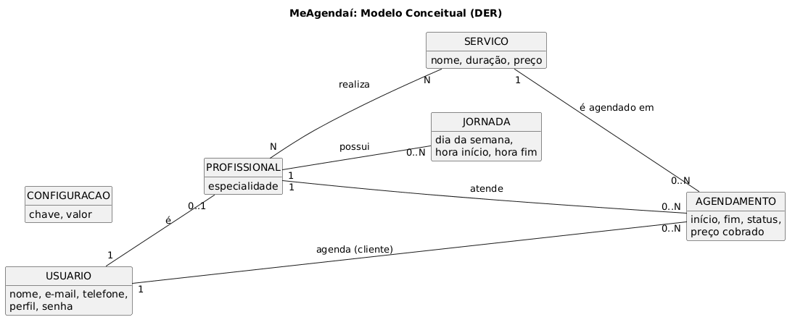
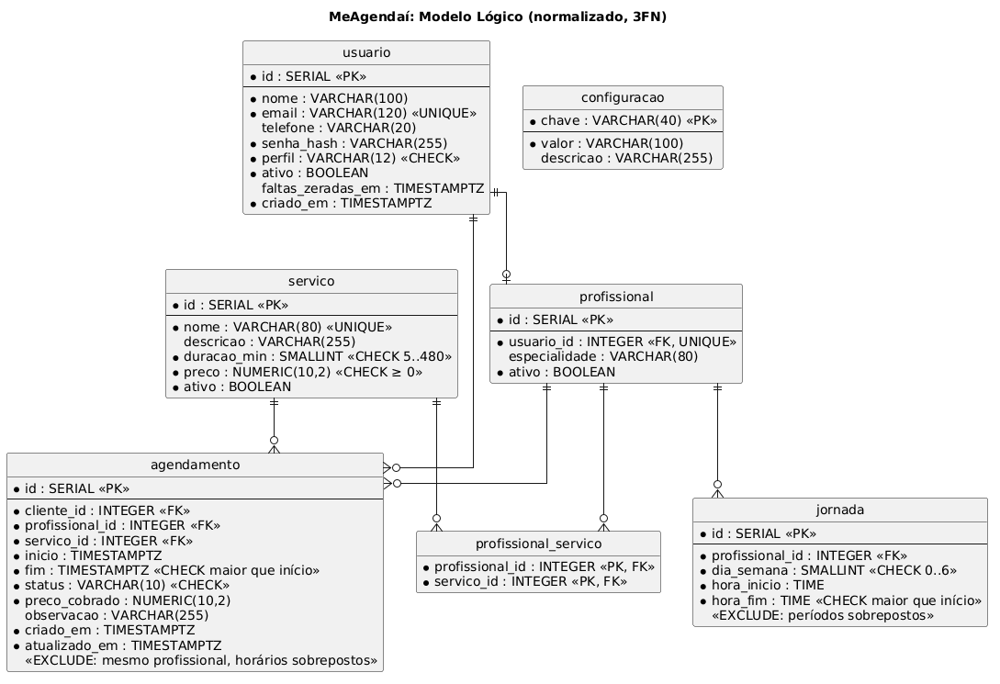

# Projeto de banco de dados

SGBD: **PostgreSQL 16**, escolhido por ser popular, gratuito e de fácil manutenção, e por oferecer a constraint
`EXCLUDE`, que impede horários sobrepostos diretamente no banco.

O projeto seguiu três etapas: **conceitual → lógico (normalizado) → físico**, sempre derivadas do diagrama de classes
de persistência (`../uml/02-classes.png`).

## 1. Modelo conceitual (DER)

| Relacionamento | Cardinalidade | Leitura |
|---|---|---|
| Usuário **é** Profissional | 1 : 0..1 | Todo profissional é um usuário (para ter login), mas nem todo usuário é profissional |
| Profissional **possui** Jornada | 1 : 0..N | Cada período de trabalho pertence a um profissional |
| Profissional **realiza** Serviço | N : N | Um profissional faz vários serviços, e um serviço é feito por vários profissionais |
| Usuário (cliente) **agenda** Agendamento | 1 : 0..N | |
| Profissional **atende** Agendamento | 1 : 0..N | |
| Serviço **é agendado em** Agendamento | 1 : 0..N | |

`CONFIGURACAO` é uma entidade independente (chave/valor) com os parâmetros das regras de negócio.

## 2. Modelo lógico (normalizado)

### Normalização
- **1FN:** todos os atributos são atômicos. O telefone é um único valor e os serviços de um profissional não ficam em
  uma coluna com lista: viraram a tabela associativa `profissional_servico`.
- **2FN:** as tabelas com chave composta (`profissional_servico`) não têm atributos não chave; nas demais, a chave é
  simples, então não há dependência parcial.
- **3FN:** não há dependências transitivas. Por exemplo, o nome do profissional não é repetido em `agendamento` (é obtido
  por `profissional → usuario`), e a **quantidade de faltas não é armazenada**: ela é calculada contando os agendamentos
  com status `FALTOU` depois de `faltas_zeradas_em`.

### Decisões que parecem redundância, mas não são
- `agendamento.fim` e `agendamento.preco_cobrado` guardam **fatos históricos** do momento do agendamento. Se o
  administrador alterar a duração ou o preço do serviço, os agendamentos antigos continuam corretos (regra RN07).
  Eles não dependem do serviço *atual*, e sim do serviço *no instante do agendamento*.
- O **status** é um domínio fechado ({AGENDADO, CANCELADO, REALIZADO, FALTOU}), implementado com `CHECK`. Como lembra
  o material da disciplina, *domínio não é a mesma coisa que tipo de dado*: o tipo é `VARCHAR(10)`, mas o domínio são
  só esses quatro valores.

## 3. Projeto físico

Script completo: [`database/schema.sql`](../../database/schema.sql). Para criar o banco: `flask init-db`.

Restrições de integridade implementadas:

| Tipo | Onde | Objetivo |
|---|---|---|
| `PRIMARY KEY` / `FOREIGN KEY` | todas as tabelas | Integridade de entidade e referencial |
| `UNIQUE` | `usuario.email`, `servico.nome`, `profissional.usuario_id` | Evitar duplicidade |
| `CHECK` | perfil, status, duração (5–480), preço (≥ 0), dia da semana (0–6), `fim > inicio` | Restringir o domínio dos atributos |
| `EXCLUDE USING gist` | `agendamento` | **RN01**: o mesmo profissional não pode ter horários sobrepostos (ignora cancelados) |
| `EXCLUDE USING gist` | `jornada` | **RN08**: períodos da jornada não podem se sobrepor no mesmo dia |
| `ON DELETE RESTRICT` | agendamento → usuário, profissional, serviço | Não apagar dados que têm histórico (usa-se exclusão lógica com `ativo`) |
| `ON DELETE CASCADE` | jornada, profissional_servico | Dados dependentes do profissional |
| Índices | `agendamento (profissional_id, inicio)`, `(cliente_id, inicio)`, `(inicio)` | Acelerar a consulta de horários, "meus agendamentos" e o painel |

## 4. Dicionário de dados

Ver [`dicionario-de-dados.md`](dicionario-de-dados.md).
