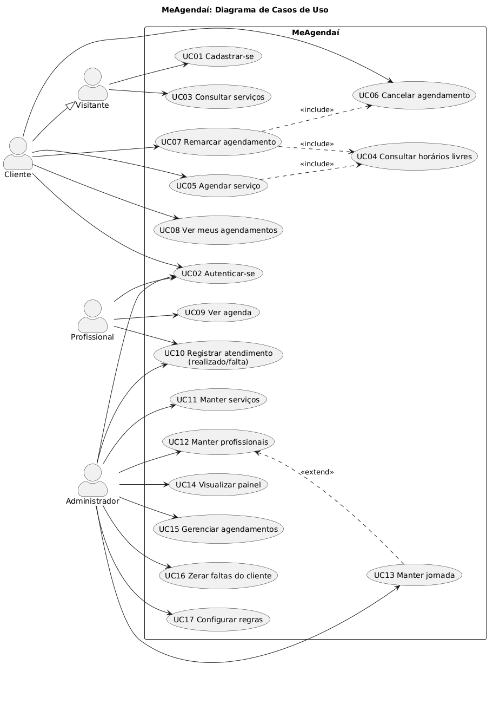
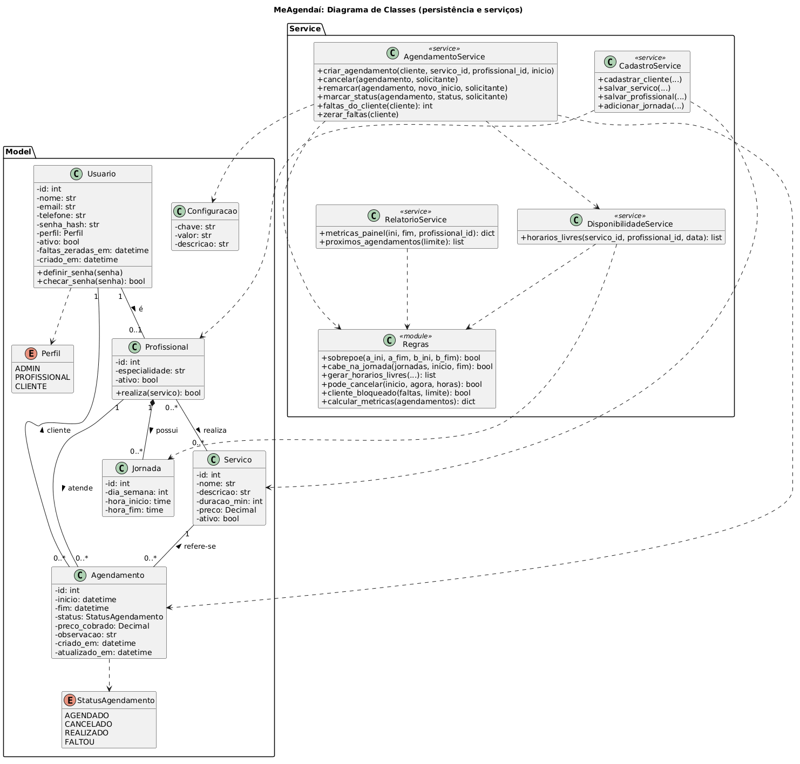
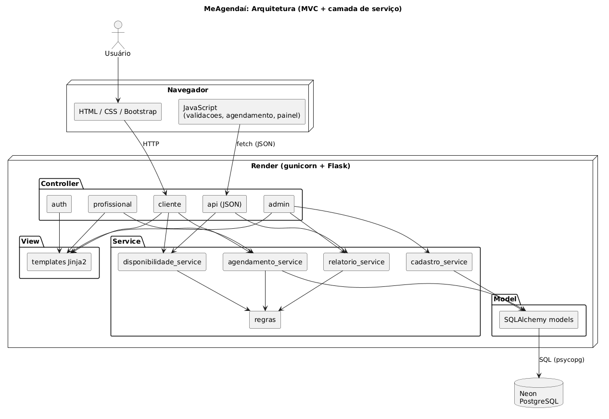
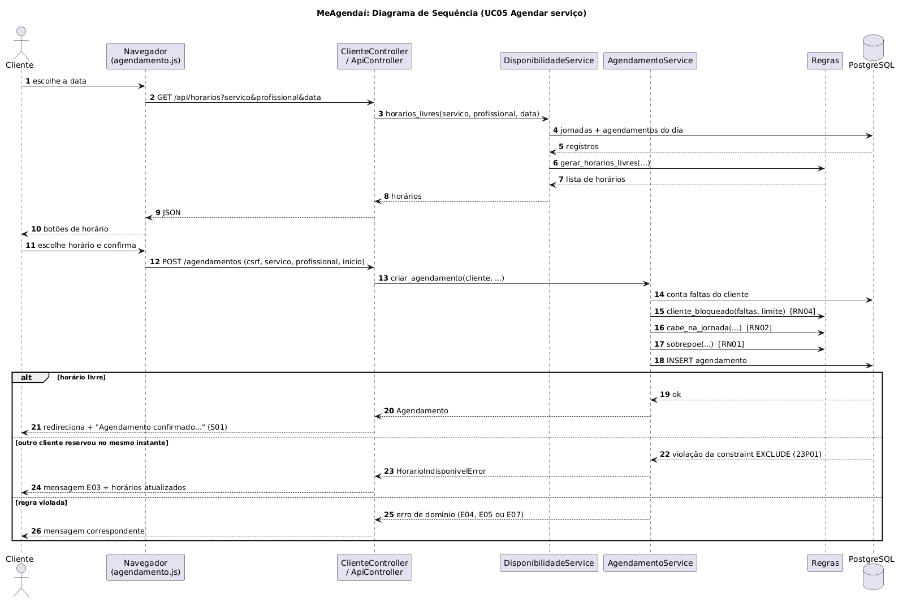
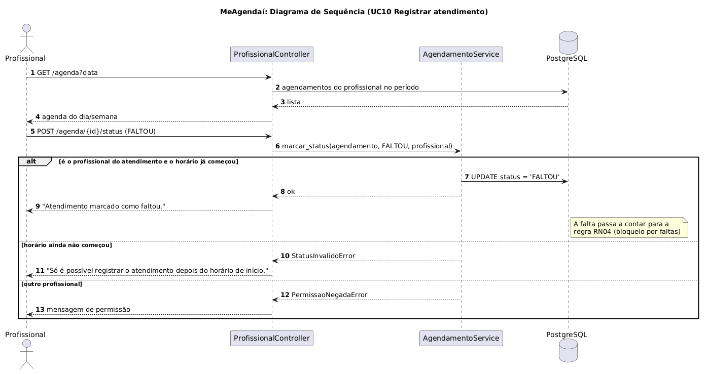
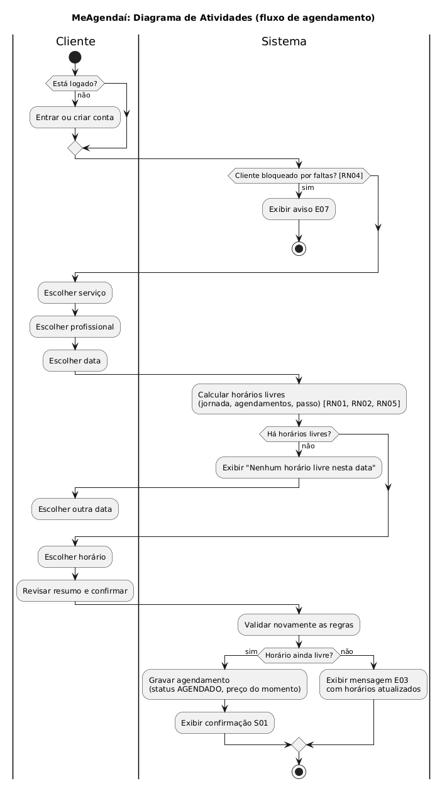
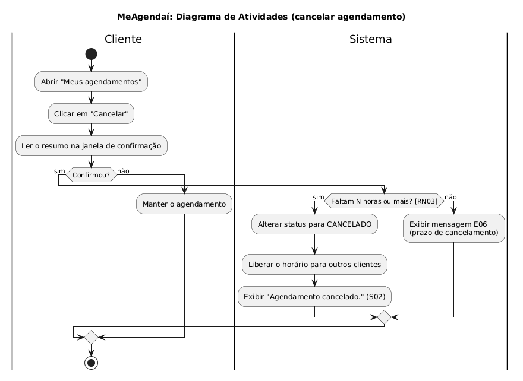
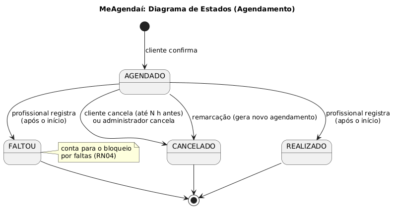

# Modelagem UML

Os diagramas foram escritos em **PlantUML** (arquivos `.puml`, versionáveis como texto) e exportados para PNG.
Para regerar as imagens: `docker run --rm -v "$PWD:/data" -w /data plantuml/plantuml -tpng -charset UTF-8 *.puml`
(ou a extensão PlantUML do VS Code).

## Diagramas estruturais

### Casos de uso
Visão geral das funcionalidades por ator. O **Cliente** herda do **Visitante** as funções públicas. Agendar e remarcar
incluem a consulta de horários livres.

### Classes (persistência e serviços)
Mostra as entidades persistidas (pacote **Model**) e a camada de serviço (pacote **Service**), onde ficam as regras de
negócio. A associação N:N entre Profissional e Servico vira a tabela `profissional_servico` no banco.

### Componentes (arquitetura MVC)
Distribuição do sistema em Controller, View, Service e Model, e onde cada parte é executada.

## Diagramas comportamentais

### Sequência: agendar serviço (UC05)
Inclui os três cenários de resposta: sucesso, horário reservado por outro cliente no mesmo instante (barrado pela
constraint do banco) e regra de negócio violada.

### Sequência: registrar atendimento (UC10)

### Atividades: fluxo de agendamento

### Atividades: cancelar agendamento

### Estados do agendamento
Ciclo de vida de um agendamento: AGENDADO só pode virar CANCELADO, REALIZADO ou FALTOU, e esses três estados são finais.

