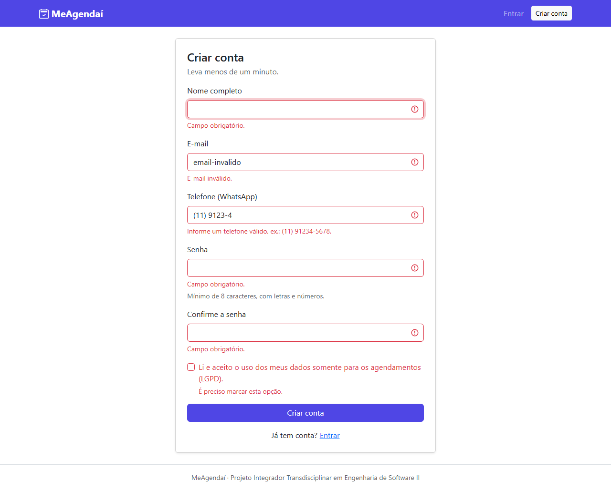
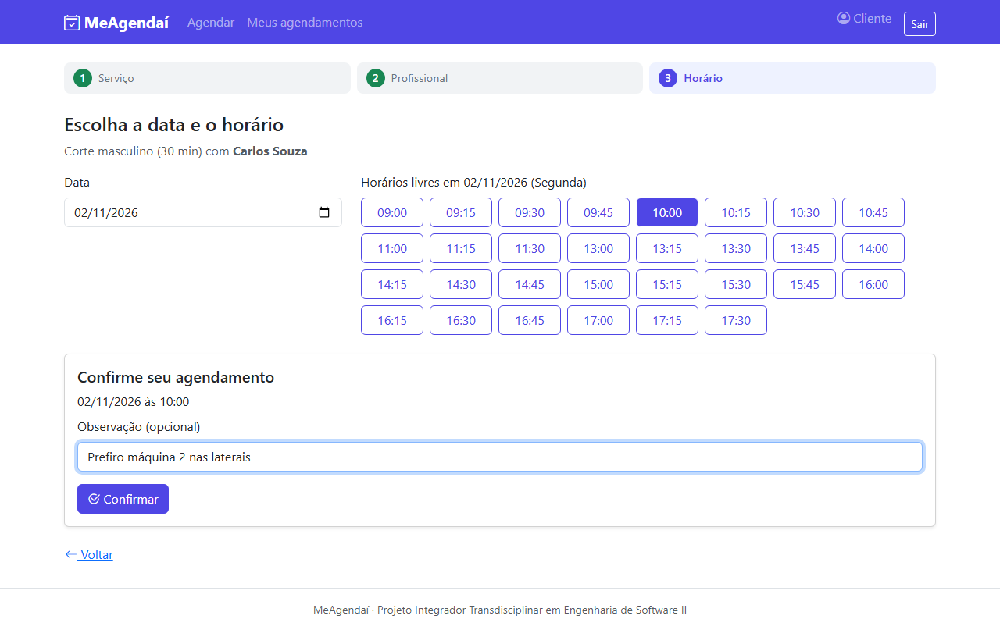
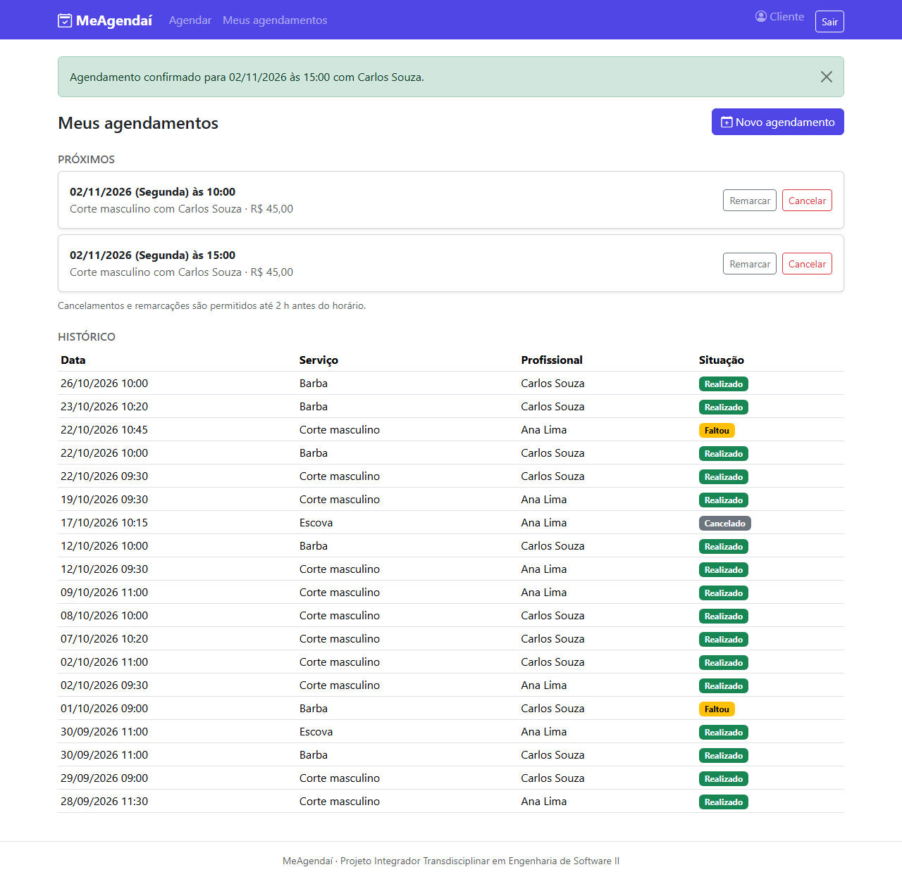
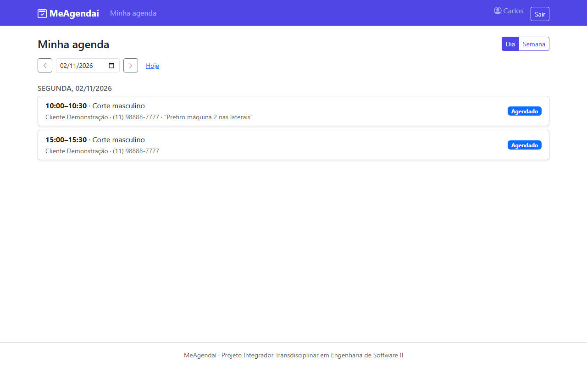
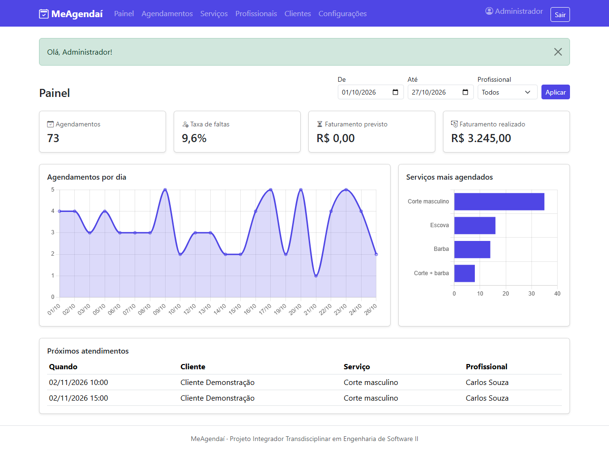
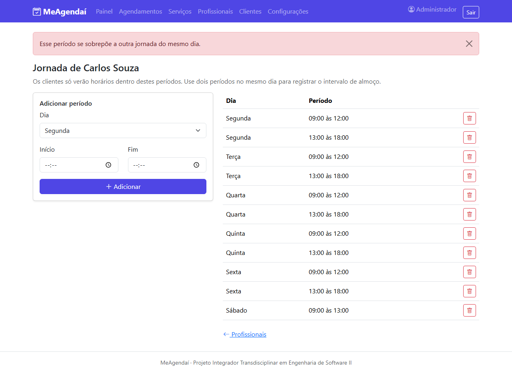

# Manual de uso do MeAgendaí

**Endereço:** _(link do sistema publicado)_

> No plano gratuito de hospedagem, o primeiro acesso depois de um período sem uso pode levar até 1 minuto.
> É só aguardar a página carregar.

### Contas de demonstração

| Perfil | E-mail | Senha |
|---|---|---|
| Administrador | admin@meagendai.com | Admin@123 |
| Profissional | carlos@meagendai.com | Prof@1234 |
| Profissional | ana@meagendai.com | Prof@1234 |
| Cliente | cliente@meagendai.com | Cliente@123 |

Também é possível criar a sua própria conta de cliente em **Criar conta**.

---

## 1. Cliente

### 1.1 Criar conta e entrar
1. Na página inicial, clique em **Criar conta**.
2. Preencha nome, e-mail, telefone (opcional) e senha (mínimo de 8 caracteres, com letras e números).
3. Marque o aceite de uso dos dados (LGPD) e clique em **Criar conta**. Você já entra logado.

Se algum campo estiver errado, a mensagem aparece logo abaixo dele.

### 1.2 Agendar um horário
1. Clique em **Agendar** no menu.
2. **Passo 1:** escolha o serviço (a duração e o preço aparecem ao lado).
3. **Passo 2:** escolha o profissional.
4. **Passo 3:** escolha a data. Aparecem **somente os horários livres**. Toque no horário desejado.
5. Confira o resumo, escreva uma observação se quiser e clique em **Confirmar**.

> Se outra pessoa reservar o mesmo horário segundos antes de você, o sistema avisa e mostra os horários que continuam livres.

### 1.3 Ver, cancelar e remarcar
Em **Meus agendamentos** ficam os próximos horários e o histórico.

- **Cancelar:** clique em **Cancelar** e confirme na janela. Só é permitido até o prazo mínimo (padrão: 2 h antes).
- **Remarcar:** clique em **Remarcar**, escolha o novo horário e confirme. Se o novo horário não estiver mais livre, o
  agendamento original continua valendo.

### 1.4 Bloqueio por faltas
Se você faltar a muitos atendimentos (padrão: 3), o agendamento online fica bloqueado. Fale com o estabelecimento para
liberar.

---

## 2. Profissional

1. Entre com o e-mail e a senha fornecidos pelo administrador.
2. A tela **Minha agenda** mostra os atendimentos do dia. Use **Dia/Semana**, as setas ou o calendário para navegar.
3. Depois do horário de início, registre o resultado de cada atendimento: **Realizado** ou **Faltou**.

---

## 3. Administrador

### 3.1 Painel
Mostra, para o período e o profissional escolhidos:
- total de agendamentos (sem os cancelados);
- taxa de faltas (faltas ÷ atendimentos concluídos);
- faturamento previsto (agendamentos futuros) e realizado (atendimentos realizados);
- gráfico de agendamentos por dia e ranking dos serviços mais agendados;
- próximos atendimentos.

### 3.2 Primeira configuração do estabelecimento
1. **Serviços → Novo serviço:** cadastre nome, duração e preço.
2. **Profissionais → Novo profissional:** cadastre nome, e-mail e senha de acesso e marque os serviços que ele realiza.
3. Ao salvar, você vai para a **Jornada**: adicione os períodos de trabalho de cada dia. Para o intervalo de almoço,
   cadastre dois períodos no mesmo dia (ex.: 09:00–12:00 e 13:00–18:00).

> Sem jornada cadastrada, o profissional não terá horários disponíveis para os clientes.

### 3.3 Dia a dia
- **Agendamentos:** veja os atendimentos de uma data, filtre por situação, registre realizado/falta ou cancele
  (o administrador pode cancelar a qualquer momento).
- **Clientes:** veja quantas faltas cada cliente tem e use **Zerar faltas** para liberar um cliente bloqueado.
- **Configurações:** ajuste a antecedência mínima de cancelamento, o limite de faltas e o intervalo entre horários.

### 3.4 Desativar em vez de excluir
Serviços e profissionais não são apagados: desmarque **Ativo**. Eles deixam de aparecer para os clientes, mas o histórico
e os relatórios continuam corretos.

---

## 4. Dúvidas frequentes

| Pergunta | Resposta |
|---|---|
| Não aparece nenhum horário | O profissional não trabalha nesse dia ou todos os horários estão ocupados. Tente outra data ou outro profissional. |
| Não consigo cancelar | O prazo mínimo de antecedência já passou. Entre em contato com o estabelecimento. |
| Apareceu "Sua sessão expirou" | A página ficou aberta por muito tempo. Recarregue e tente de novo. |
| Esqueci a senha | Peça ao administrador. A recuperação automática de senha é uma evolução prevista. |
